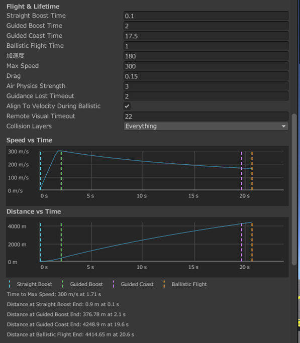
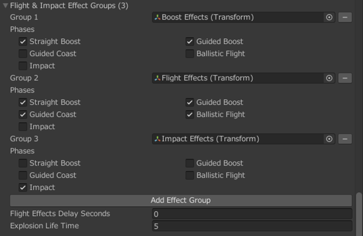

# 基本的な設定

## 飛翔特性の設定

### `FSE_MissileController`

- `StraightBoostTime`、`GuidedBoostTime`、`GuidedCoastTime`、`BallisticFlightTime`で、4つの飛翔フェーズの継続時間をそれぞれ秒単位で設定します。各フェーズの概要については[飛翔フェーズ](behavior.md#phases)を参照してください。
- `Acceleration`で発射後の推進加速度を設定します。`MaxSpeed`で最高速度を制限します。
- `Drag`で速度の二乗に比例する空気抵抗係数を設定できます。全飛翔フェーズで作用します。
- インスペクター上では、初速を0 m/sとしたときの各フェーズでのミサイル速度と飛距離の推移をプレビューグラフで確認できます。

{ width="900" loading=lazy }

- Flight Instabilityを有効にすると、動力飛翔中に滑らかな上下左右の揺らぎ（弾道不安定性）を加えます。
- `RollVisualRoot`を設定すると、物理挙動に影響を与えずに見た目（メッシュ）の自転ロール回転を付与できます。

## 飛翔・着弾エフェクトの設定

### `FSE_DFUNC_MissileLauncher`

- 発射時に再生するエフェクト、またはエフェクトを子に持つオブジェクトを`Launch Effects Root`へ指定します（親自身に直接配置しても機能します）。
- 配布プレハブでは設定済みです。旧バージョンの`Launch Sound`／`Launch Particle`を使用した独自プレハブの場合は、エフェクトをまとめた親オブジェクトを`Launch Effects Root`へ指定し直してください。

### `FSE_MissileController`

- 飛翔中および起爆時に再生するエフェクトを`Flight & Impact Effect Groups`に設定します。
- `Add Effect Group`をクリックし、エフェクト（パーティクル・トレイル・オーディオ音源）、またはエフェクトを子に持つオブジェクトを`Group`へ指定します。
- 各`Group`ごとに、エフェクトを再生する飛翔タイミングのチェックボックスを有効化します。

{ width="900" loading=lazy }

## 誘導方式固有の設定

### MCLOS誘導の設定

#### `FSE_MCLOSInputController`

- `InputDeadZone`はVRスティックの中央付近（不感帯）に適用されます。
- `InvertPitch`と`InvertYaw`で操作方向を軸ごとに反転できます。
- `SyncInterval`は操作状態を同期送信する間隔（秒）です。

#### `FSE_MCLOS Guidance`

- `MaxPitchRate`、`MaxYawRate`は、上下・左右の旋回能力（角速度）を指定します。
- `MaxLateralAcceleration`は、上下左右を合わせた旋回にかかる横加速度の上限を指定します。

### SACLOS誘導の設定

#### `FSE_SACLOSGuidance`

- `GuidanceLookAhead`は、ミサイルが追従目標とする照準線上の前方先読み距離です。
- `MinimumCommandDistance`は、近距離で操舵目標点がミサイルに接近しすぎて挙動が乱れるのを防ぐ最短距離です。
- `MaxGuidanceAngle`は、照準線に対して誘導指令を受け付ける許容角度範囲です。
- `MaxTurnRate`と`MaxLateralAcceleration`は旋回角速度と横加速度を制限します。過大な値を設定すると不自然な急旋回が発生するため注意してください。
