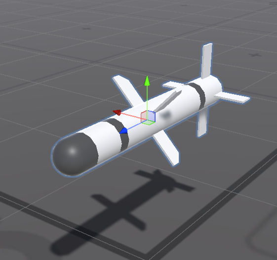

# FSE Guided Missiles

FSE Guided Missilesは、Saccの乗り物に誘導ミサイルを搭載するためのギミックです。

- 共通機能：発射、飛翔、着弾、再装填、補給、発射制限、ミサイルのプール管理
- 対応する誘導方式
    - MCLOS：射手が飛翔中のミサイルへ直接上下左右の旋回指令を送信
    - SACLOS：照準線へ向けてミサイルを自動誘導

{ width="900" loading=lazy }

## パッケージに含まれるプレハブ

### 完成品サンプルプレハブ

`Assets\Furunin\SaccExtensions\Prefabs\Guided Missile`以下にあります。

| ファイル名 | 説明 |
| --- | --- |
| `SH-1_GuidedMissile_MCLOS` | SH-1にMCLOSミサイルを設定した完成品サンプル |
| `SH-1_GuidedMissile_SACLOS` | SH-1にSACLOSミサイルを設定した完成品サンプル |

### 部品プレハブ

`Assets\Furunin\SaccExtensions\Prefabs\Guided Missile\SubComponents`以下にあります。

| ファイル名 | 説明 |
| --- | --- |
| `FSE_GuidedMissile` | FSE Guided Missilesの関連コンポーネントをまとめたプレハブ。独自車両にFSE Guided Missilesを搭載する際に利用できます |
| `Missile Round_Stowed` | 発射前ミサイルの関連コンポーネントをまとめたプレハブ。`FSE_GuidedMissile`内で使用します |
| `Missile Round_InFlight` | 飛翔中ミサイルの関連コンポーネントをまとめたプレハブ。`FSE_GuidedMissile`内で使用します |
| `SH-1_GuidedMissile_Base` | 完成品サンプルに誘導方式別設定を行う前のサンプル。完成品サンプル内で使用します |
| `FixedLauncher_Component` | 固定ランチャーを別のSacc車両に載せる際に使用するプレハブ。[固定ランチャーを車両に載せる](optional-features.md#fixed-launcher-on-vehicle)を参照してください |

!!! Warning
    パッケージ内のプレハブは直接編集せず、プレハブバリアントを作成するか、プレハブを展開して使用してください。元のプレハブを直接編集すると、パッケージ更新時に変更内容が上書きされ、正しく動作しなくなるおそれがあります。

## ギミック導入手順

[導入手順](installation.md)を参照してください。
