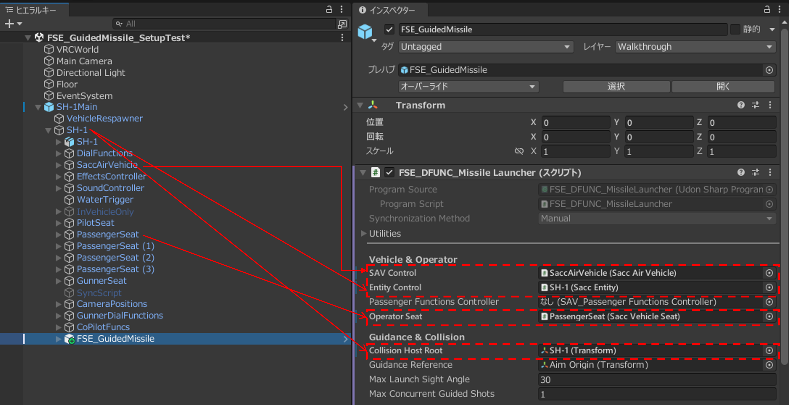
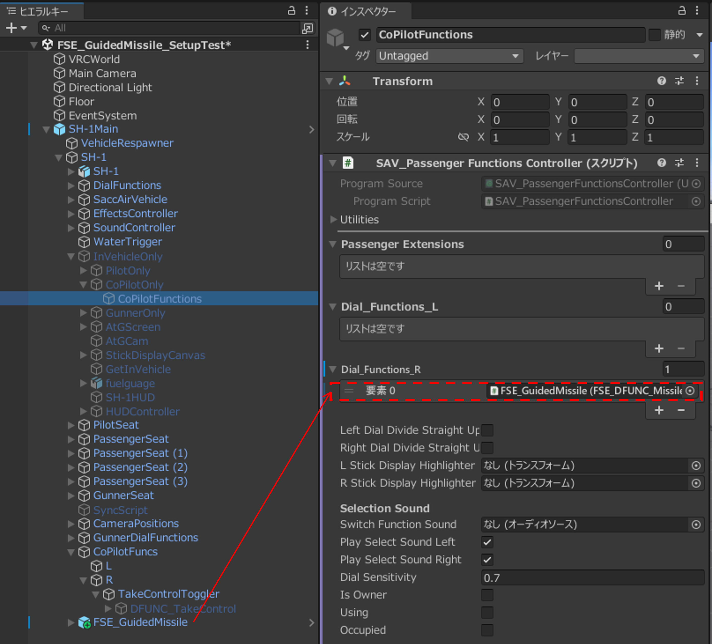
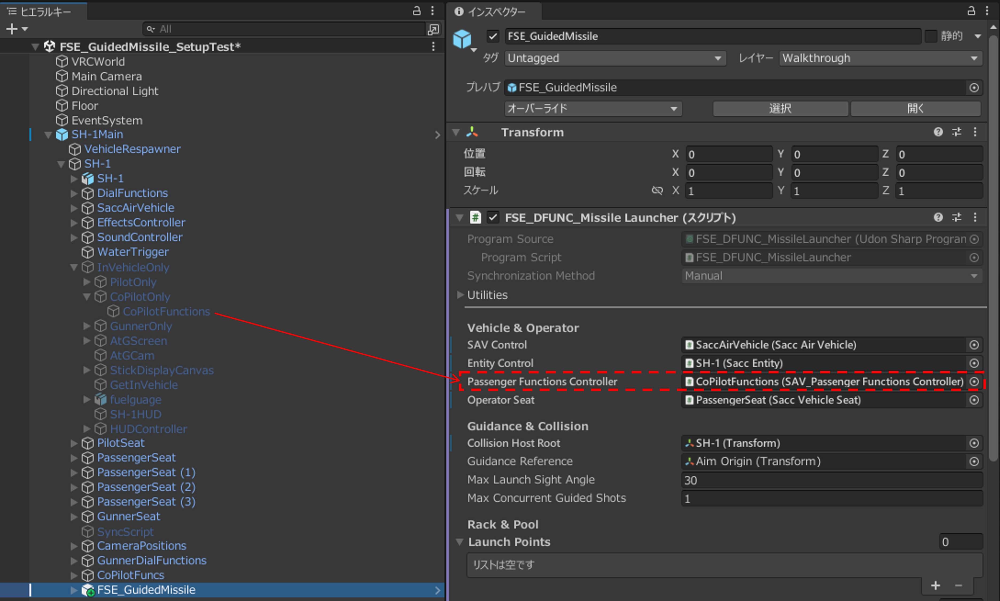
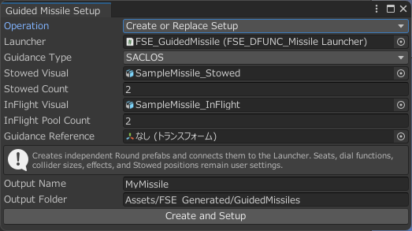
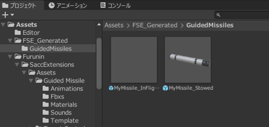
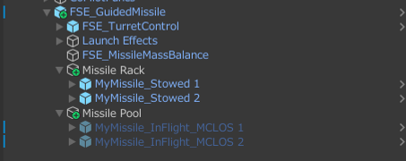
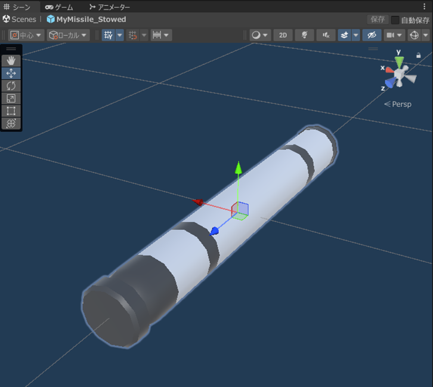

# 導入手順

以下は各誘導方式に共通する導入手順です。この共通セットアップを完了した後に、各誘導方式固有の設定を行います。

## 1. 乗り物の事前準備

Guided Missileをセットアップする対象の乗り物にSaccを導入し、正常に動作することを確認します。このページではセットアップ済みの乗り物として、Sacc付属のSH-1を使用します。

## 2. FSE_GuidedMissileを配置する

1. `Assets/Furunin/SaccExtensions/Prefabs/Guided Missile/SubComponents/FSE_GuidedMissile`プレハブを、乗り物の`Sacc Entity`配下へ配置します。
2. `FSE_GuidedMissile`オブジェクトの`FSE_DFUNC_MissileLauncher`に以下の設定を行います。

    | Field | 説明 |
    |---|---|
    | `SAVControl` | 乗り物の`Sacc Air Vehicle`コンポーネントを指定します。 |
    | `EntityControl` | 乗り物の`SaccEntity`コンポーネントを指定します。 |
    | `CollisionHostRoot` | ミサイルの衝突判定から除外するオブジェクトの階層を指定します。 |
    | `OperatorSeat` | ミサイルの発射・誘導を行う操作席のオブジェクトを指定します。 |

{ width="900" loading=lazy }

## 3. 操作席の設定をする

### 3-A. PassengerSeatで操作する場合

1. PassengerSeatの`Sacc Vehicle Seat`内にある`Passenger Functions`が参照する`SAV_PassengerFunctionsController`を選択し、インスペクターを開きます。

    !!! Note "Passenger Functionsが未設定の座席を使用する場合"

        乗り物内のオブジェクトへ`SAV_PassengerFunctionsController`を追加し、そのコンポーネントを対象の`PassengerSeat`にある`Sacc Vehicle Seat`の`Passenger Functions`へ指定してください。以降の手順では、ここで指定したコントローラーを使用します。

2. `SAV_PassengerFunctionsController`の`Dial_Functions_L`または`Dial_Functions_R`に、`FSE_GuidedMissile`オブジェクト（`FSE_DFUNC_MissileLauncher`）を登録します。

    { width="900" loading=lazy }

    !!! Info "座席機能の交代について"
        `FSE_DFUNC_TakeControl`を使用すると、任意の座席間で機能を交代できます。乗り物の操縦とミサイル操作を2人で分担することも、1人ですべて担当することも可能です。設定手順は[任意の設定](optional-features.md#fse-take-control)を参照してください。

3. `SAV_PassengerFunctionsController`を、`FSE_GuidedMissile`の`FSE_DFUNC_MissileLauncher`内にある`PassengerFunctionsController`へ登録します。

    { width="900" loading=lazy }

### 3-B. PilotSeatで操作する場合

PilotSeatでミサイルを選択している間は、操縦と照準操作が干渉しないよう、機体操縦の入力が一時的に制限されます。

1. `PassengerFunctionsController`は空欄のままにします。
2. `FSE_DFUNC_MissileLauncher`を、セットアップ対象の乗り物の`SaccEntity`にある`Dial_Functions_L`または`Dial_Functions_R`に登録します。

## 4. ミサイルのセットアップをする

ミサイルを機能させるには、各ミサイルや照準器の参照設定、および誘導方式別のスクリプト設定が必要です。専用のセットアップツールを使用すると、誘導方式別の設定を施したミサイルプレハブの生成と、参照設定済みのミサイル配置を自動で行えます。

!!! Info "手動でセットアップを行う場合"
    セットアップツールを使わずに導入する場合は、[ミサイルを手動でセットアップする](manual-installation.md)を参照してください。

1. メインメニューの`Tools/Furunin Sacc Extensions/Guided Missiles/Guided Missile Setup`を選択してセットアップツールを開きます。

2. ツールの各項目を設定します。

    { width="600" loading=lazy }

    | 項目名 | 説明 |
    | --- | --- |
    | `Operation` | ツールの動作を選択します。新規セットアップ時は`Create or Replace Setup`を選択します。 |
    | `Launcher` | 配置した`FSE_DFUNC_MissileLauncher`を指定します。 |
    | `Guidance Type` | 使用する誘導方式を選択します。 |
    | `Stowed Visual` | 格納状態のミサイルの見た目を指定します。プロジェクト内のプレハブまたはFBXを指定してください。 |
    | `Stowed Count` | 格納状態のミサイル数を指定します。 |
    | `InFlight Visual` | 飛翔状態のミサイルの見た目を指定します。プロジェクト内のプレハブまたはFBXを指定してください。 |
    | `InFlight Pool Count` | 飛翔状態のミサイルプール数を指定します。`Stowed Count`と一致させる必要はありません。 |
    | `Output Name` | 作成するミサイルの名前を指定します。 |
    | `Output Folder` | 格納状態／飛翔状態ミサイルのプレハブを保存するフォルダを指定します。 |
    | `Guidance Reference` | （SACLOS選択時のみ）ミサイル誘導の基準となるオブジェクトを指定します。付属の`FSE_TurretControl`を利用する場合は、`FSE_GuidedMissile/FSE_TurretControl/Yaw Pivot/Pitch Pivot/Aim Origin`を指定してください。 |

    !!! Info "格納状態と飛翔状態のミサイルの数"
        格納状態のミサイル数（`Stowed Count`）は、ランチャー外観などで表示したい搭載数に合わせて設定します。飛翔状態のミサイル数（`InFlight Pool Count`）は、ワールド内に同時に存在しうる最大弾数を指定してください。ワールド内に存在する飛翔中ミサイルが`InFlight Pool Count`に達した状態でさらに発射すると、最も古いミサイルから順に再利用（プール再割り当て）されます。

3. `Create and Setup`を実行します。指定したフォルダに格納状態と飛翔状態のミサイルプレハブが生成され、`FSE_DFUNC_MissileLauncher`配下に指定した数のプレハブが自動配置されます。
    { width="900" loading=lazy }
    { width="900" loading=lazy }
4. 指定フォルダに生成された格納状態ミサイルプレハブ（`Missile Round_Stowed`）と飛翔状態ミサイルプレハブ（`Missile Round_InFlight`）を開き、ミサイルモデルが各プレハブのZ軸+（青い矢印）方向を向いているか確認します。向きが合っていない場合はプレハブを開いてモデルの向きを修正し、保存してください。
    { width="900" loading=lazy }
5. `Missile Launcher`配下に生成された`Missile Round_Stowed`プレハブの位置と回転を機体に合わせて調整します（`Missile Round_InFlight`プレハブの位置調整は不要です）。

!!! Info "生成済みプレハブを利用した設定変更"
    セットアップ後に見た目や飛翔特性などの設定を変更したい場合は、生成された格納状態／飛翔状態ミサイルのプレハブを編集することで、配置済みの全ミサイルへ一括反映できます。

!!! Note "セットアップツールで既存構成を変更・検証する"
    - `Operation`で`Update Existing Setup`を選択すると、既存セットアップの誘導方式、見た目、格納状態／飛翔状態ミサイルの数を変更できます。
    - `Operation`で`Validate Launcher Setup`を選択すると、既存セットアップの設定に不備がないかを検証できます。

!!! Note "テンプレートの更新を生成済みプレハブへ反映する"
    生成済みの格納状態／飛翔状態ミサイルのプレハブは、パッケージ更新によるテンプレートの変更を自動では受け取りません。テンプレートの変更を取り込む場合は、次の手順で反映します。

    1. メインメニューの`Tools/Furunin Sacc Extensions/Guided Missiles/Round Template Sync`を選択します。セットアップツールで作成したプレハブが一覧に表示されます。
    2. 反映するプレハブにチェックを入れ、`Analyze Selected`を押します。変更される値（現在の値→テンプレートの値）と、追加・削除される部品が表示されます。
    3. 内容を確認し、`Apply`を押します。

    プレハブの見た目（`Visual/User Visual`）、誘導方式、センサー設定、テンプレートにない部品（追加した部品）とその参照は維持されます。それ以外の値（エフェクト、飛翔性能、ダメージ、発射位置など）は、プレハブで調整した値も含めてテンプレートの値で上書きされます。このプレハブを使用するランチャー、プレハブバリアント、シーンにも反映されます。`Remove objects and components the template does not have`を有効にすると、テンプレートにない部品を削除します（見た目・誘導方式・センサーは削除しません）。既定は無効です。

    `Apply`はCtrl+Zで元に戻せません。実行前の状態は自動で保存され、`Restore Last Backup`で直前の状態へ戻せます。実行前に、プロジェクトのバックアップまたはバージョン管理での保存も行ってください。古い形式の格納状態プレハブやプレハブバリアントは対象外で、一覧に理由が表示されます。

## 5. 照準器の設定をする

- `FSE_GuidedMissile`配下にある`FSE_TurretControl`を使用してタレットを制御し、`Guidance Reference`に指定した`Aim Origin`を任意の方向へ指向させることができます。[FSE Turret Controlのセットアップ手順](../turret-control/installation.md)を参照してセットアップしてください。

## 6. ギミックのカスタマイズをする

上記の手順で、ギミックの基本動作が有効になります。ミサイルの飛翔特性やエフェクト、誘導に関する詳細設定は[基本的な設定](basic-settings.md)を、任意機能の導入は[任意の設定](optional-features.md)を参照してください。
