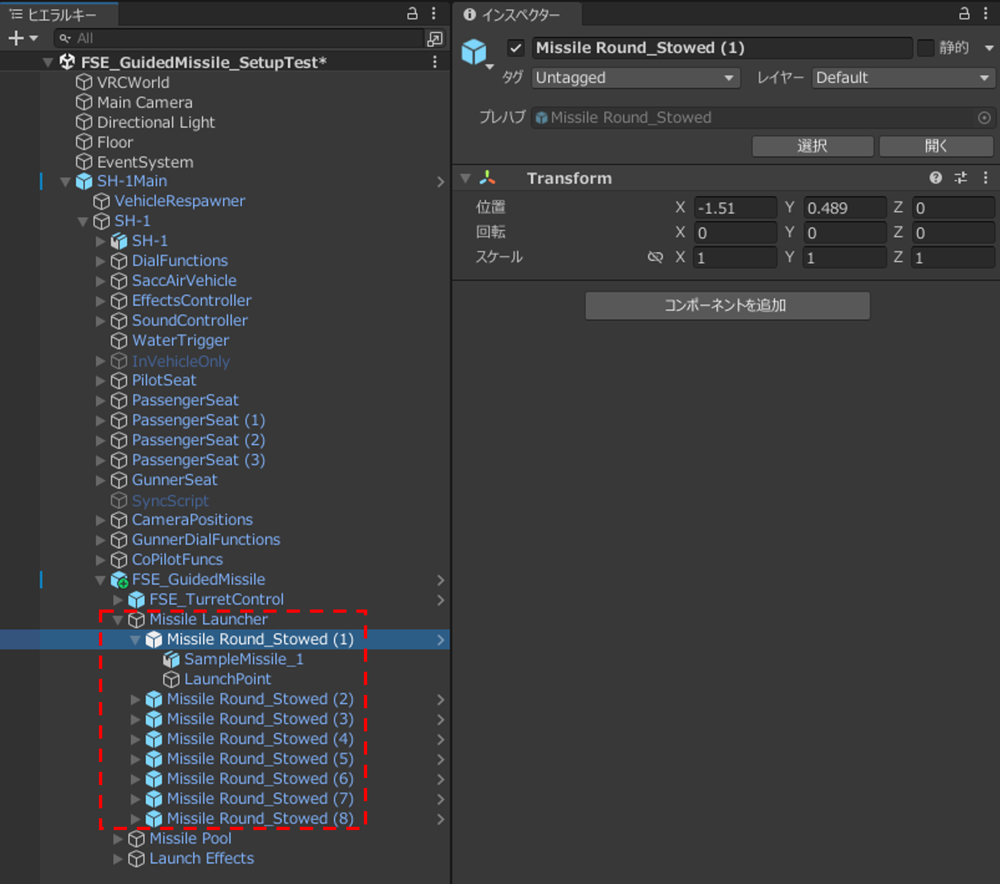
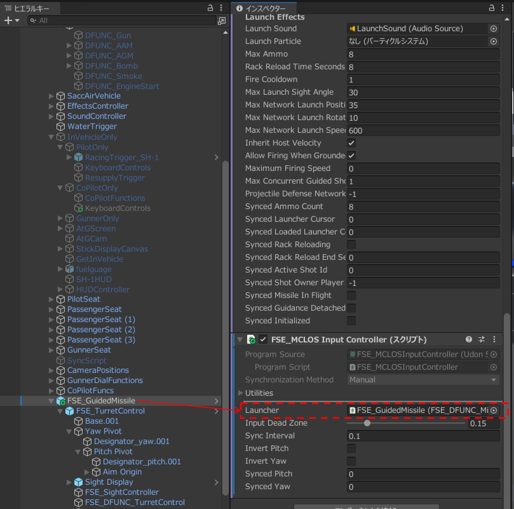
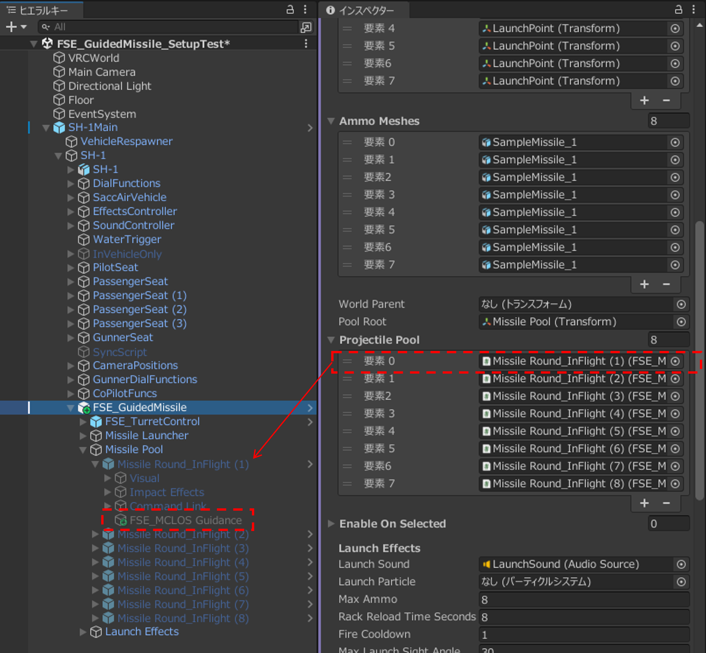
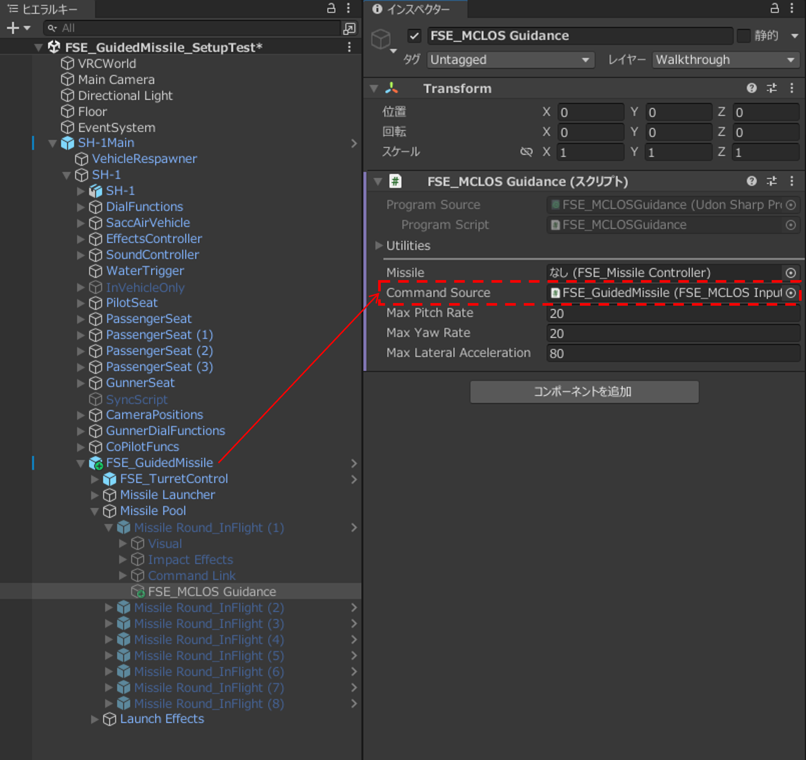
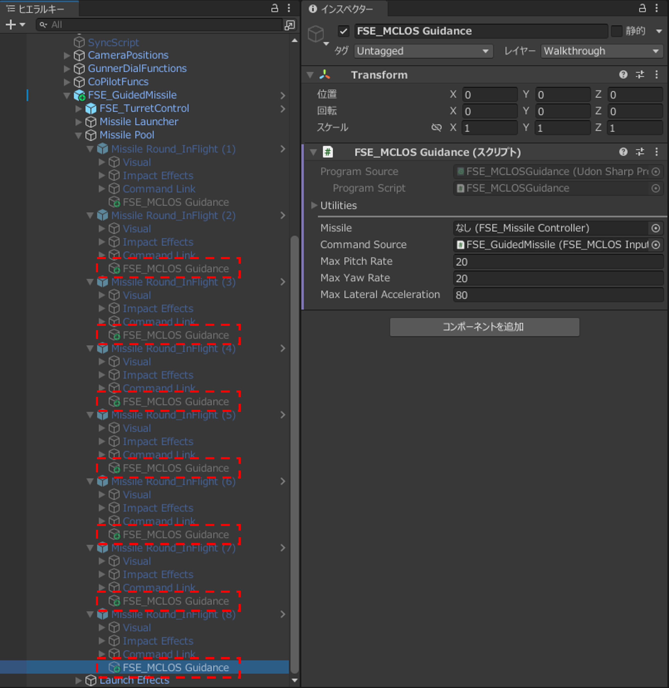
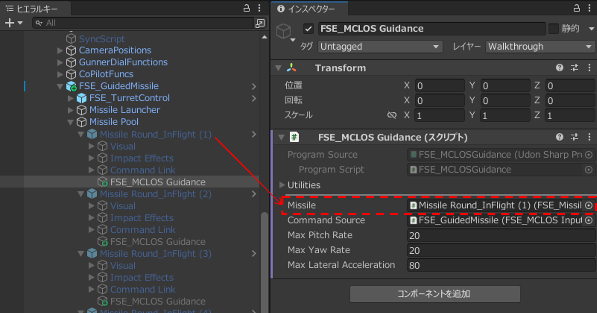
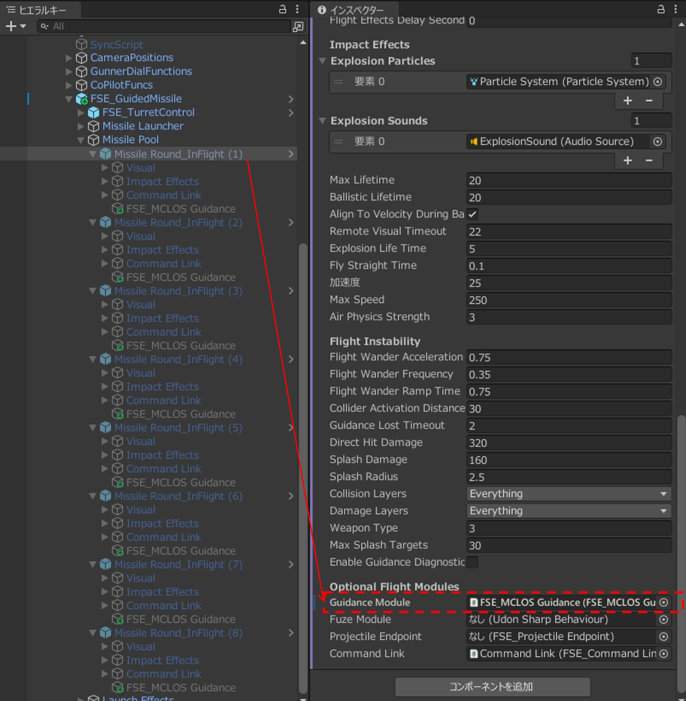

# ミサイルを手動でセットアップする

## 1. ミサイルの発射位置と搭載弾表示を調整する

`Missile Launcher`配下にある`Missile Round_Stowed`の位置と回転を調整します。各格納状態ミサイルの`FSE_MissileLaunchStation`において、`LaunchPoint`に発射位置のトランスフォームを指定し、ローカル+Z軸（青い矢印）方向を発射方向へ向けます。`VisualRoot`には搭載弾の外観オブジェクトのみを指定し、`FSE_DFUNC_MissileLauncher`の`LaunchStations`へ各ステーションを発射順に登録してください。メッシュを差し替えることで独自の3Dモデルを使用できます。

{ width="900" loading=lazy }

## 2. 照準器を乗り物へ接続する

- 誘導方式にSACLOS以外を使用する場合は、この手順は任意です。
- 誘導方式にSACLOSを使用する場合は、誘導の基準となるオブジェクトを指定する必要があります。旋回する照準器（砲塔）に基準オブジェクトを配置するとミサイルを任意の方向へ誘導できますが、固定オブジェクトを利用することも可能です。砲塔を使用する場合は、`FSE_GuidedMissile`プレハブに付属する`FSE_TurretControl`を利用できます（[セットアップ手順](../turret-control/installation.md)）。

## 3. 誘導方式別の導入をする

### 3-A. MCLOS方式の導入

MCLOSでは、射手が飛翔中のミサイルへ直接上下左右の旋回指令を送信します。操作入力をニュートラルに戻すと、その時点の進行方向を維持して直進します。

#### 3-A-1. MCLOS入力を設定する

1. `FSE_GuidedMissile`へ`FSE_MCLOSInputController`コンポーネントを追加します。
2. 追加した`FSE_MCLOSInputController`の`Launcher`へ、`FSE_GuidedMissile`の`FSE_DFUNC_MissileLauncher`を指定します。

    { width="900" loading=lazy }

#### 3-A-2. 各ミサイルへ誘導コンポーネントを設定する

1. `FSE_GuidedMissile`オブジェクトの`FSE_DFUNC_MissileLauncher`コンポーネントをインスペクターで開きます。`ProjectilePool`に登録されている1番目のオブジェクト配下に空のオブジェクトを作成し、名前を`FSE_MCLOS Guidance`に変更します。

    { width="900" loading=lazy }

2. 作成した`FSE_MCLOS Guidance`オブジェクトに`FSE_MCLOS Guidance`コンポーネントを追加し、`CommandSource`へ`FSE_GuidedMissile`オブジェクト（`FSE_MCLOSInputController`）を指定します。

    { width="900" loading=lazy }

3. `FSE_MCLOS Guidance`オブジェクトを複製し、`ProjectilePool`に登録されている2番目以降のオブジェクト配下へそれぞれ配置します。

    { width="900" loading=lazy }

4. Missile Pool配下のすべてのミサイルについて、以下の設定を行います。
  
    - `FSE_MCLOS Guidance`の`Missile`に、同じミサイルの`Missile Round_InFlight`オブジェクト（`FSE_MissileController`）を指定します。

        { width="900" loading=lazy }

    - `Missile Round_InFlight`オブジェクトの`FSE_MissileController`コンポーネントにある`GuidanceModule`に、同じミサイルの`FSE_MCLOSGuidance`オブジェクトを指定します。

        { width="900" loading=lazy }

### 3-B. SACLOS方式の導入

SACLOSでは、ミサイルが`GuidanceReference`の示す照準線へ向けて自動的に旋回します。射手は飛翔中も照準を目標へ向け続けます。

#### 3-B-1. GuidanceReferenceを設定する

`FSE_GuidedMissile`オブジェクトの`GuidanceReference`に、ミサイルの誘導基準となる照準線オブジェクトを指定します。`FSE Turret Control`を使用する場合は、`FSE_TurretControl`内の`Aim Origin`を指定してください。SACLOSは照準線をもとに誘導を行うため、この参照設定が必須です。

#### 3-B-2. 各ミサイルへ誘導コンポーネントを設定する

1. `FSE_GuidedMissile`オブジェクトの`FSE_DFUNC_MissileLauncher`コンポーネントをインスペクターで開きます。`ProjectilePool`に登録されている1番目のオブジェクト配下に空のオブジェクトを作成し、名前を`FSE_SACLOS Guidance`に変更します。
2. `FSE_SACLOS Guidance`オブジェクトに`FSE_SACLOS Guidance`コンポーネントを追加します。
3. Missile Pool配下のすべてのミサイルについて、以下の設定を行います。
  
    - `FSE_SACLOS Guidance`の`Missile`に、同じミサイルの`Missile Round_InFlight`オブジェクトを指定します。
    - `Missile Round_InFlight`オブジェクトの`FSE_MissileController`コンポーネントにある`GuidanceModule`に、同じミサイルの`FSE_SACLOSGuidance`オブジェクトを指定します。
