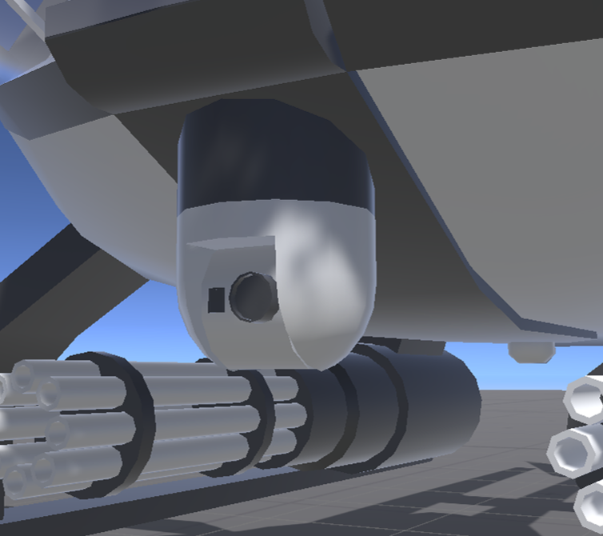

# FSE Turret Control

FSE Turret Controlは、照準器や砲塔のように1つまたは2つの回転軸を持つタレットを操作するギミックです。

- ヨー軸・ピッチ軸の双方、または片方の軸を持つタレットの手動操作
- タレットモデルの差し替え
- 基準タレットと同じ方向を向く追従タレットの複数設定
- HMD（VRモード）または視線（デスクトップモード）へ追従するHEAD SLAVE機能
- 照準カメラの視野角に応じた旋回速度の自動補正

{ width="900" loading=lazy }

単独で車両の砲塔や照準カメラの制御に使えるほか、Guided Missilesの照準器としても利用できます。

## パッケージに含まれるプレハブ

`Assets\Furunin\SaccExtensions\Prefabs\Turret Control`以下にあります。

| ファイル名 | 説明 |
| --- | --- |
| `FSE_TurretControl` | 本ギミック導入用プレハブ。 |
| `Sight Display` | 照準映像の表示に使用するプレハブ。`FSE_TurretControl`内で使用します。 |

!!! Warning
    パッケージ内のプレハブは直接編集せず、プレハブバリアントを作成するか、プレハブを展開して使用してください。元のプレハブを直接編集すると、パッケージ更新時に変更内容が上書きされ、正しく動作しなくなるおそれがあります。

## ギミック導入手順

[導入手順](installation.md)を参照してください。
