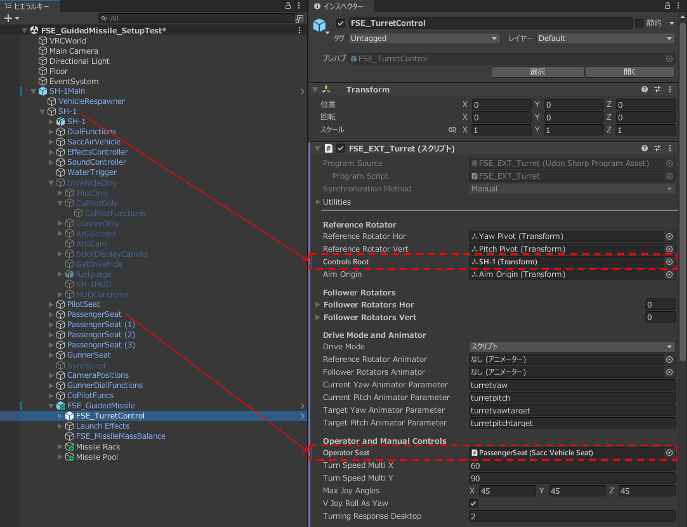
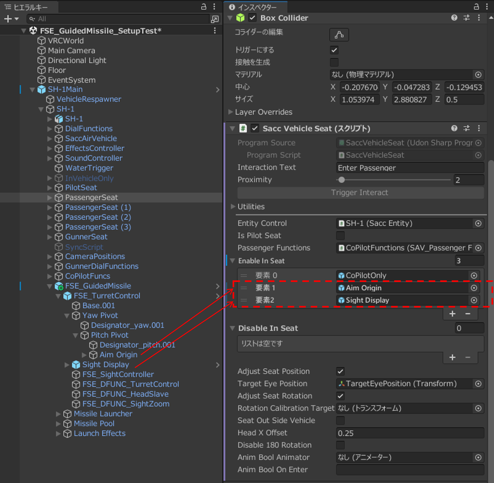
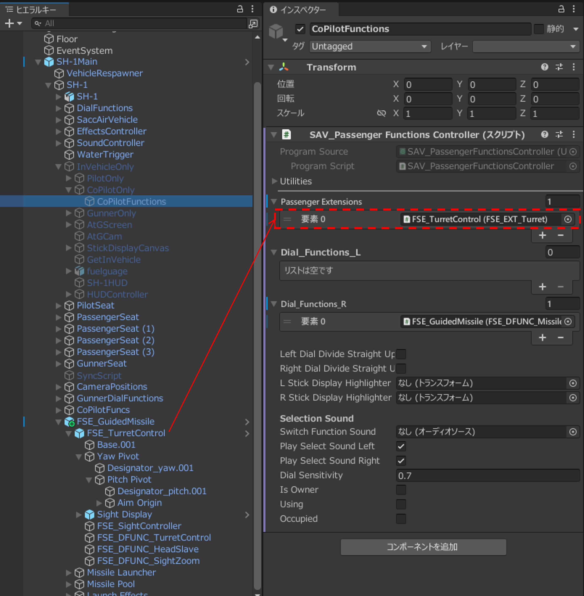
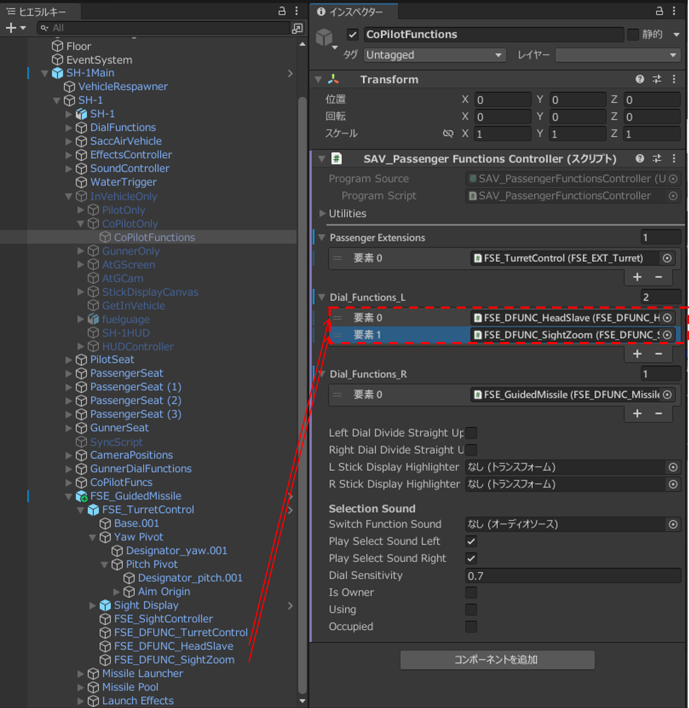
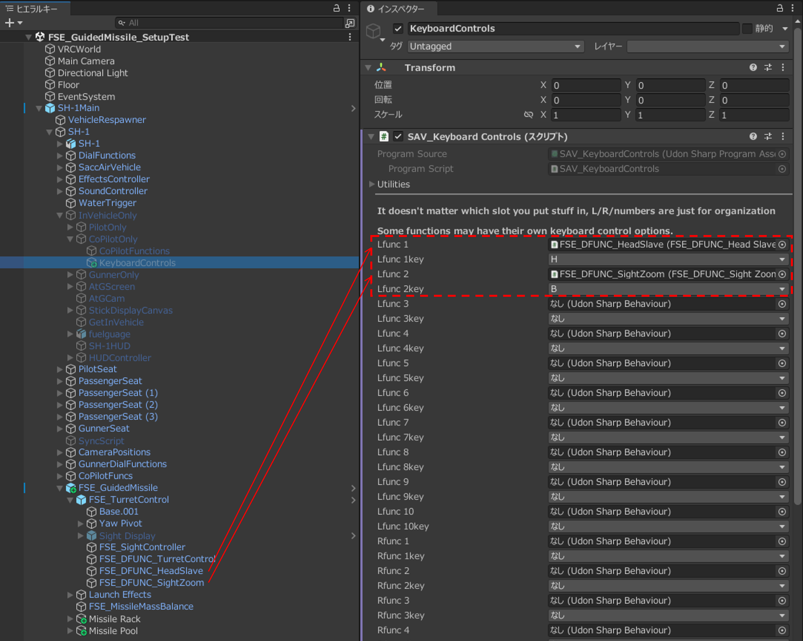

# セットアップ

## 1. FSE_TurretControlプレハブを配置する

セットアップ対象の車両ヒエラルキーに`FSE_TurretControl`がない場合は、`FSE_TurretControl`プレハブを配置します。

## 2. FSE_EXT_Turretの設定をする

### 2-1. 共通の設定をする

`FSE_TurretControl`オブジェクトの`FSE_EXT_Turret`に以下の設定をします。基準タレットが`Aim Origin`の方向を決め、追従タレットがその方向に追従します。

| Field | 説明 |
|---|---|
| `Reference Rotator Hor` | 基準タレットのローカルY軸で左右に回転するトランスフォームを指定します。 |
| `Reference Rotator Vert` | 基準タレットのローカルX軸で上下に回転するトランスフォームを指定します。 |
| `ControlsRoot` | 対象の乗り物と共に動き、ローカルの+Z軸が車両前方を向くトランスフォームを指定します。 |
| `OperatorSeat` | タレットを操作する座席のオブジェクトを指定します。 |

!!! note
    左右または上下のどちらか一方しか回転軸がない場合は、不要な側の`Reference Rotator Hor`または`Reference Rotator Vert`を空欄のままにします。

{ width="900" loading=lazy }

### 2-2. タレットの制御方式を選択する

タレットの旋回制御は、スクリプトによる直接制御とアニメーターによる制御の2通りから選択できます。

!!! note
    アニメーター制御モードを選択した場合は、`FSE_EXT_Turret`が各回転軸の目標角度を計算し、実際の旋回動作はアニメーター側で行います。

!!! note
    スクリプト制御モードを選んだ場合でも、`Reference Rotator Animator`や`Follower Rotators Animator`に指定したアニメーターを通じて、各回転軸の角度パラメーター（`Current/Target Yaw/Pitch Animator Parameter`）を出力できます。

#### 2-2-A. スクリプトで制御する場合

- `Drive Mode`のドロップダウンで`Script`を選択します（初期値は`Script`です）。
- 追従タレットを設定する場合は、`Follower Rotators Hor / Vert`に追加したいタレットのヨー／ピッチ回転軸を指定します。

#### 2-2-B. 自作アニメーターで制御する場合

- `Drive Mode`のドロップダウンで`Animator`を選択します。
- `Reference Rotator Animator`に、基準タレットの旋回アニメーションを設定したアニメーターを指定します。
- アニメーター側に`Current/Target Yaw/Pitch Animator Parameter`で指定した名前のFloatパラメーターを作成し、モデルの動きに合わせてアニメーションを組みます。
- 追従タレットを設定する場合は、`Follower Rotators Animator`に追従タレット用のアニメーターを指定します（`Reference Rotator Animator`と同一でも構いません）。

## 3. 操作席の設定をする

### 3-1. 共通の設定をする

タレット操作席の`Sacc Vehicle Seat`オブジェクトにある`EnableInSeat`へ、以下のオブジェクトを登録します。

- `FSE_TurretControl/Yaw Pivot/Pitch Pivot/Aim Origin`
- `FSE_TurretControl/Sight Display`

{ width="900" loading=lazy }

### 3-2. `FSE_EXT_Turret`を`ExtensionUdonBehaviours`に登録する

#### 3-2-A. PassengerSeatで操作する場合

- PassengerSeatの`Sacc Vehicle Seat`内にある`Passenger Functions`が参照する`SAV_PassengerFunctionsController`を選択し、インスペクターを開きます。
- `PassengerExtensions`に`FSE_TurretControl`オブジェクト（`FSE_EXT_Turret`）を登録します。

{ width="900" loading=lazy }

#### 3-2-B. PilotSeatで操作する場合

- 対象の乗り物の`SaccEntity`のインスペクターを開きます。
- `ExtensionUdonBehaviours`に`FSE_TurretControl`オブジェクト（`FSE_EXT_Turret`）を登録します。
- 単独の砲塔として操作する場合は、`FSE_TurretControl`の子オブジェクトである`FSE_DFUNC_TurretControl`を、操作席の`Dial_Functions_L`または`Dial_Functions_R`へ登録します。

## 4. 任意機能を設定する

デスクトップモードにおいてHEAD SLAVE機能やSight Camera／Zoom機能をDialFunctionから選択・操作できるようにするには、割り当てた座席に対応する`KeyboardControls`でキーを設定します。`KeyboardControls`がない場合は空のオブジェクトを作成し、`SAV_KeyboardControls`コンポーネントを追加してください。

### HEAD SLAVE

照準を頭（VR）や視点（デスクトップ）の向きへ追従させる機能です。使用する場合は、`FSE_DFUNC_HeadSlave`を操作席の`Dial_Functions_L`または`Dial_Functions_R`に登録します。

### Sight Camera／Zoom

照準映像のズーム（拡大・縮小）や距離測定を行う機能です。使用する場合は、`FSE_DFUNC_SightZoom`を操作席の`Dial_Functions_L`または`Dial_Functions_R`に登録します。

{ width="900" loading=lazy }

{ width="900" loading=lazy }

### 独自の照準画面・HUD { #custom-ui-setup }

利用者がUdonSharpで作成したUIを使う場合は、次の参照を設定します。

1. 自作UIのスクリプトへ、測距に使用する`FSE_SightController`を参照させます。標準の距離表示を使わない場合は、そのComponentの`Rangefinder Text`を空欄にします。
2. カメラや機体の姿勢も表示する場合は、UIへ`SightCamera`と、機体に固定されたトランスフォームを参照させます。機体固定の参照には、照準操作で回転しない`ControlsRoot`または`SaccEntity`のトランスフォームを使用します。

測距結果と姿勢の読み取り方は[基本的な設定](basic-settings.md#custom-ui)を参照してください。
